# Luxtable

<p align="center">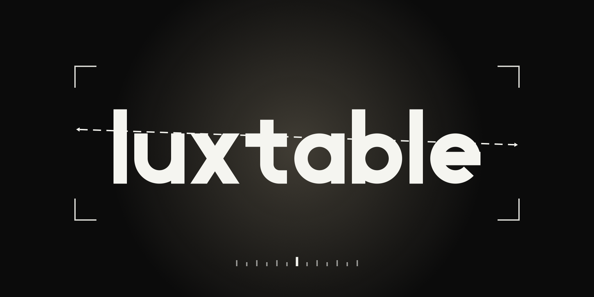</p>

<p align="center"><b>A fast, local-first RAW photo workflow for macOS.</b><br>
Card import, culling, sessions, editing, export and archiving, with a Rust core on the GPU and a native SwiftUI app.<br>
<a href="https://luxtable.app">luxtable.app</a> · Formerly Darkslide.</p>

<p align="center">
  <a href="LICENSE"></a>
  
  <a href="docs/Luxtable-User-Guide.pdf"></a>
</p>

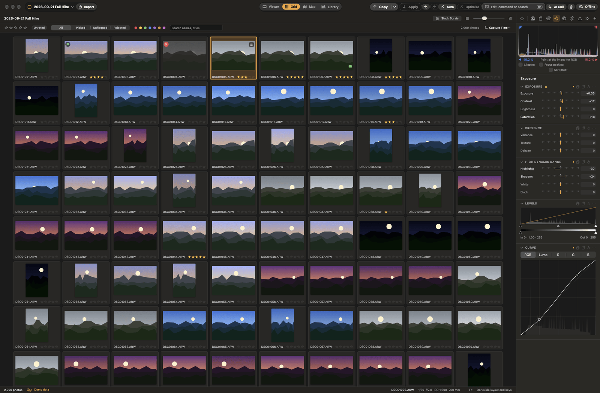

Luxtable is built for photographers who shoot a lot and want to get from the card to the keepers quickly: Capture One–style sessions, culling at the speed of your fingers, a GPU develop pipeline, and backups that never delete anything.

**Contents:** [Why Luxtable](#why-luxtable) · [Feature tour](#feature-tour) · [How it works](#how-it-works) · [Cameras](#supported-cameras) · [Install](#install-and-build-from-source) · [Privacy](#privacy-and-network-use) · [Docs](#documentation) · [Roadmap](#roadmap) · [Contributing](#contributing) · [Licence](#licence)

## Why Luxtable

- **Instant browsing.** Thumbnails come from the RAW file's embedded preview straight away, and full renders fill in behind them, visible photos first. Moving to the next photo with the keyboard takes under 50 ms.
- **Smooth editing.** The whole develop pipeline runs as GPU compute (Metal via wgpu). Dragging a slider re-renders a screen-sized proxy in 16 ms or less ([budgets](docs/ARCHITECTURE.md#budgets-release-build-m4-pro-a9-arw-file-in-page-cache)).
- **Sessions, not a catalog.** Each session is a self-contained folder. Per-photo sidecars are the source of truth, and the SQLite index can be rebuilt from them at any time. Sessions can live on any drive, including a NAS, and Library mode still shows every session's photos in one grid.
- **Your files are never lost.** Every write is atomic, imports are verified with BLAKE3 checksums before they count as done, nothing is ever deleted from a memory card or from the archive, and moved or renamed files are found again by content hash.
- **Nothing leaves your Mac unless you ask.** AI features run on device. What does use the network is listed under [Privacy and network use](#privacy-and-network-use).

## Feature tour

The screenshots are taken in demo mode (`--demo`): synthetic photos, no people, no real files. A full walk-through is in the [user guide (PDF)](docs/Luxtable-User-Guide.pdf).

### Import from a card

Luxtable detects memory cards, copies in parallel and verifies each file's checksum before the import counts as done. It skips anything already imported into any session, renames with templates, can resume an interrupted import, and offers a safe eject. Nothing is ever deleted from the card.

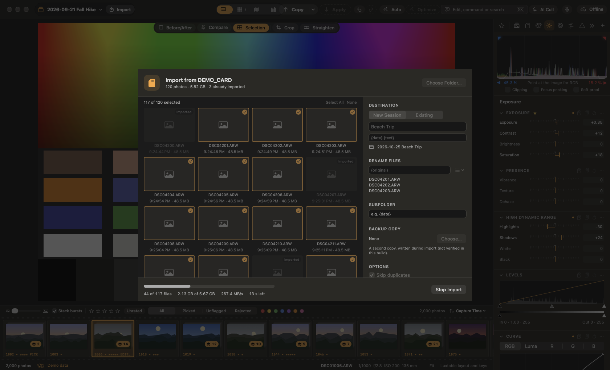

### Cull fast

- Grid, viewer, filmstrip and full-screen views. Space jumps to 100% at the cursor.
- Ratings (`1`–`5`), colour labels (`6`–`9`, `-`) and pick / reject flags (`P` / `X`), all on single keys you can rebind.
- **Multi-view:** select several photos and the viewer shows them all, the focused one outlined.
- **Survey** (`N` or ⌥⌘S) for side-by-side picks, before/after (`Y`), pin-to-compare (`K`) and burst stacks (the highest-rated frame is the cover; ties go to your pick, saved with the session, or the AI's).
- **AI Cull** (⇧⌘K) scores sharpness, exposure and eyes on device and groups near-duplicates.
- **Voice culling** (⌃⌘V): say "pick", "reject", "three stars" or "next 3"; speech is recognised on device.
- Finish a cull in one step: rejects go to the session Trash and picks to Selects, both undoable.

| Grid | Multi-view | Survey |
|---|---|---|
| 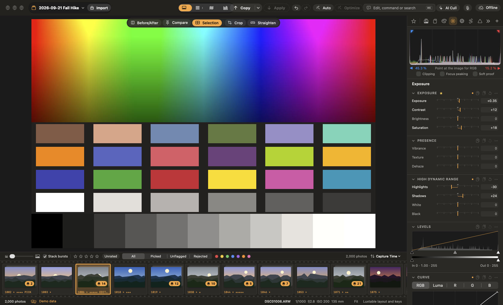 | 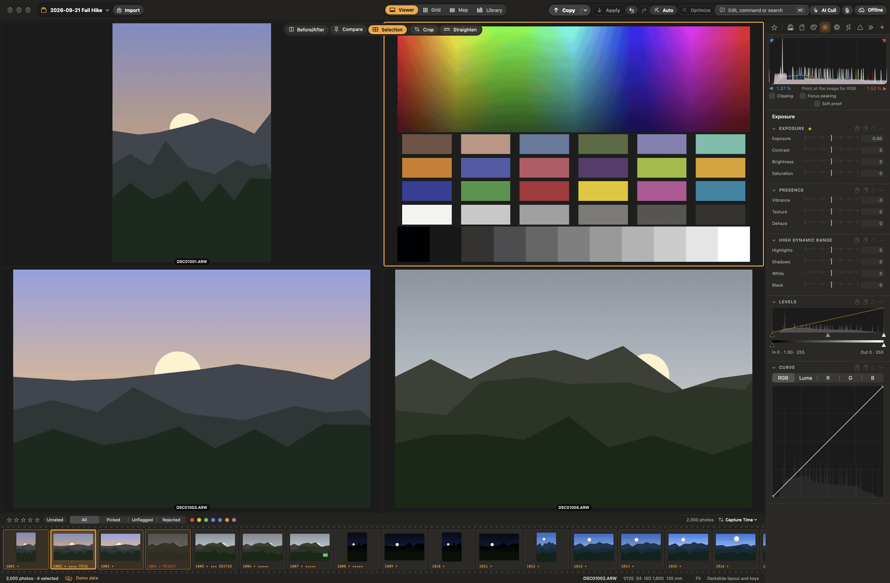 | 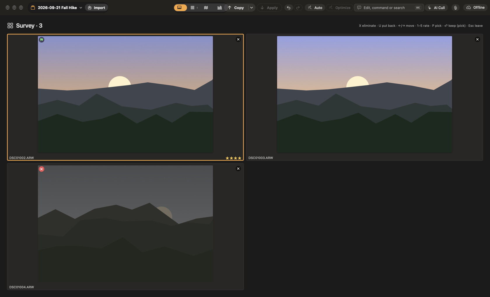 |

### Library, Find and Map

- **Library mode** shows every session's photos in one grid without opening each session: browse by session, date or collection, filter by rating, label, flag, camera and keyword, and make collections and smart collections that span sessions. ⌘-click sessions to see them as one, or pick Opened Sessions to see every session you have opened together. Ratings and labels you set there are written to the photo's own session. Open it with File ▸ Browse All Sessions in Library (⇧⌘L), or set Settings ▸ General ▸ Open in to Library to start there without loading a session. Photos load as you scroll, so a large Library opens quickly.
- **Find** (⌘F) answers searches like "pics of alex at the beach" from the people you have named, places, dates, ratings and descriptive words, with the reason each result matched. Face grouping and photo search run on device.
- **Map** shows where photos were taken and filters the browser to an area; drag photos onto it to set their location (kept in the sidecar, never written to the RAW).

### Develop

A GPU pipeline with Capture One–style tool tabs you can rearrange, a CPU reference implementation it is tested against, and full-resolution 1:1 views.

- **Light and colour:** exposure, contrast, high dynamic range, levels, curves, white balance (presets, temperature/tint and a picker with a loupe), colour balance, colour editor, saturation and vibrance.
- **Looks, styles and presets** that preview as you hover, camera profiles (and imported Adobe DCP profiles), and Match exposure / white balance across photos.
- **Layers and masks:** brush, linear and radial gradients, luminance and colour range, and AI masks for sky, subject and people.
- **Remove and heal:** brush over a distraction and it is filled from its surroundings, or heal and clone spots.
- **Detail and lens:** clarity, structure, dehaze, sharpening, noise reduction, lens profiles, chromatic aberration, vignetting, keystone and an AI lens blur.
- **Crop and straighten** with aspect presets; drag along the horizon to level it.
- **Merge to HDR and Panorama** (⇧⌘H / ⇧⌘M): a new linear DNG next to the sources, with a RAW's full latitude.
- **Best Shot** (⇧⌘B): one photo from a burst, starting from its best frame and taking open eyes, better faces and sharper areas from the others; it becomes the burst's cover unless you chose one.
- **Copy and apply** (⇧⌘C / ⇧⌘V): all edited adjustments or just the groups you tick, with aspect-aware crop paste and relative exposure paste.
- **Variants** (⌘D) and a per-session **History**.

| Live edit | White balance loupe |
|---|---|
| 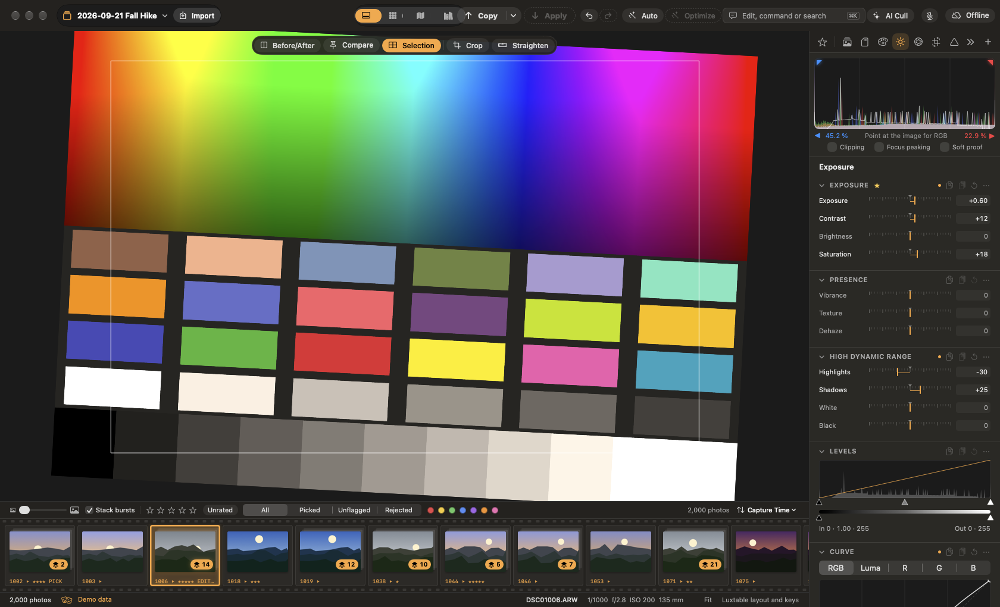 | 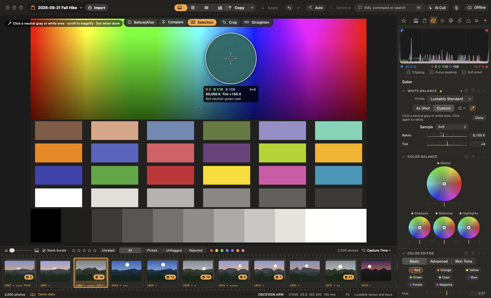 |
| **Crop** | **1:1 zoom** |
| 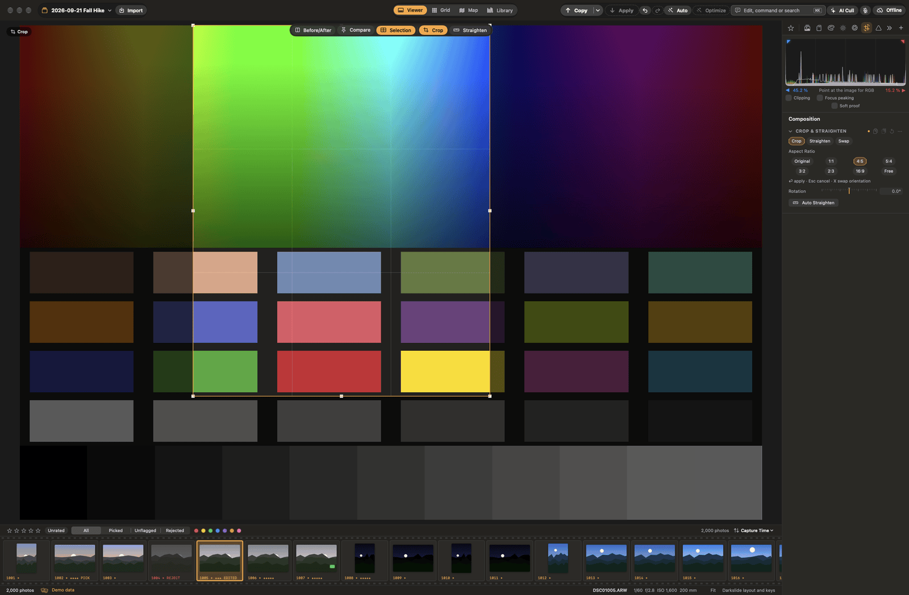 | 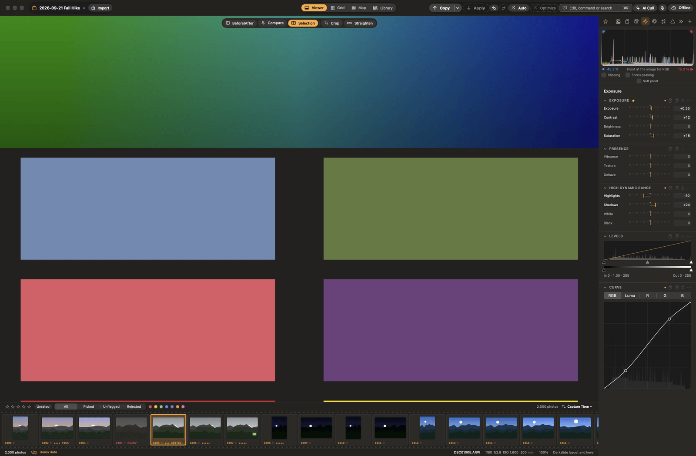 |
| **Your own tool tabs** | **Edit with words** |
| 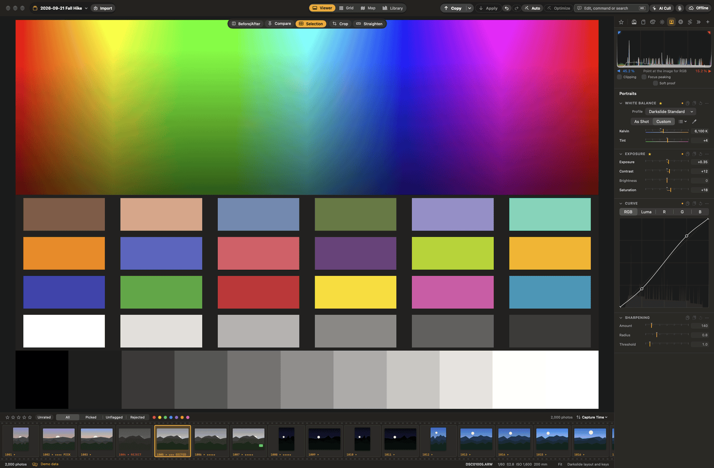 |  |

### AI that explains itself, on device

- **Edit with words** (⌘K): type "warmer and a bit brighter" and only what you name changes.
- **AI Optimize** (⌥⌘A) proposes measured adjustments and explains each one; you choose which to apply.
- **Auto Adjust** (⇧A) gives a one-key starting point.
- **AI Changes** (⌥⇧⌘A): every setting an AI tool changed is outlined, with its old and new value and why. Undo one or all of them; your own edits since are kept.
- **AI Denoise** and **AI Upscale** (2×) make new results on this Mac.


### Export, archive and back up

- **Export recipes** (⌘E): JPEG, HEIC, 16-bit TIFF and PNG; size, sharpening, colour space, naming, watermarks and metadata per recipe, several recipes in one go, in the background. Soft proofing (⇧S) shows the photo through any ICC profile.
- **Google Photos** (optional): a recipe can also upload into an album in your Google Photos account ([setup](docs/GOOGLE_PHOTOS.md)).
- **Archive** (optional): sessions copied in the background, on a schedule, to a folder (a NAS share, an external drive or a local folder) or to S3-compatible object storage (see [Archive](#archive) below). It never deletes from the archive.
- **Amazon Photos hand-off** (optional): originals are copied into the folder Amazon Photos backs up.
- **Immich** (optional): your edited photos, stars and tags in a self-hosted [Immich](https://immich.app) server that indexes the archive (see [Immich](#immich) below).
- The optional ones are off until you turn them on in Settings ▸ Plugins (see [Optional integrations](#optional-integrations)).
- **Metadata in every export:** star rating (`xmp:Rating`), keywords as `dc:subject`, `lr:hierarchicalSubject` and `digiKam:TagsList`, and optionally the colour label and pick flag as `Luxtable/Label/Red`, `Luxtable/Pick`, `Luxtable/Reject` tags.


### Archive

Settings ▸ Archive picks where sessions go. Each session gets its own folder there; switching destinations never moves or deletes what is already archived.

- **Folder:** rsync to a mounted volume (a NAS share under `/Volumes`, an external drive) or a local folder. Nothing is written while the volume isn't mounted: changes wait, and the archive catches up when it is back. A local folder must exist (and can't be inside a session or Luxtable's own support folder).
- **Object storage:** any S3-compatible service: Amazon S3, Backblaze B2, Wasabi, Cloudflare R2, MinIO. Enter the endpoint (empty for Amazon S3, which uses the region), the region, the bucket, a path (key prefix: `luxtable/` puts a session at `luxtable/<session>/…`) and, if the service needs it, path-style addressing. The access key ID and secret access key are kept only in your Keychain, never in preferences or files; the secret is never shown again. Test Connection checks the bucket and leaves one small test object under the path in `.lt-archive-test/`.

Either way, the archive never deletes anything. A file that changed is archived again only after its previous version is moved aside (a folder's `.lt-archive-trash/<time>/`, or copied to `<path>.lt-archive-trash/<time>/` in the bucket). Unchanged files are skipped (on object storage by a BLAKE3 hash stored with each object); every upload is checked against its MD5 and SHA-256 by the service and verified afterwards; large files go up in 8 MB parts. The live session database is never copied, only a consistent snapshot of it, and caches and half-written files stay out. Developed copies and XMP sidecars travel with the session. Immich needs a folder it can index, so with object storage its album sync is skipped (Settings ▸ Immich says so); the Amazon Photos hand-off works with either destination.

### Immich

Immich can index the archive folder as an **external library** (mounted read-only is fine): Luxtable never uploads to Immich, and Immich never writes to the share. Turn it on in Settings ▸ Plugins, then set it up in Settings ▸ Immich:

1. Enter the server address and an API key (Immich ▸ Account Settings ▸ API Keys; it is kept in your Keychain). Test Connection.
2. Tell Luxtable where Immich sees the archive, e.g. `/mnt/photos` on the server is `/Volumes/photos` on this Mac. Detect fills it in from an archived photo Immich already has, or from the library's import path.
3. Choose photos and use **Photo ▸ Keep a Developed Copy for Immich** (also in the browser's context menu): a full-size JPEG with every edit goes to the session's `Developed/` folder, is rendered again when you edit, re-rate or re-tag the photo, and the archive carries it to the NAS. A badge on the thumbnail shows the copy (orange when out of date). **Stop Updating Developed Copy** leaves the existing file alone: nothing deletes from the archive.
4. With **XMP sidecars** on (the default), `IMG_0001.ARW.xmp` next to each archived original carries stars, title, caption, keywords and position, so RAWs show them in Immich too. A sidecar Luxtable didn't write (Lightroom, Capture One) is never touched.
5. **Albums** follow rules ("★★★★★" → "Luxtable ★★★★★") across every archived session. After each archive run (or Sync Albums Now) Luxtable asks Immich to rescan, then adds the matching photos (the developed copy when there is one) and removes only the photos it added itself. Photos you put in an album by hand stay.

Rate and tag in Luxtable: Immich shows what the sidecars and developed copies say. If you only want the developed JPEGs in Immich, add the exclusion pattern `**/*.ARW` (and your other RAW extensions) to the external library. Album changes and scan requests are the only things Luxtable asks of Immich; scans need an admin's API key (otherwise Immich finds new files on its own schedule).

### Optional integrations

Four integrations are built in but off until you turn them on, so Luxtable stays out of services you don't use. Turn each on or off in **Settings ▸ Plugins ▸ Integrations**; its own Settings tab appears while it is on.

| Integration | What it does | Where to set it up |
|---|---|---|
| **Archive** | Copies sessions to a drive or NAS in the background with rsync; never deletes from the archive. Onboarding offers it. | Settings ▸ Archive |
| **Amazon Photos** | Copies originals into the folder the Amazon Photos app backs up. | Settings ▸ Amazon Photos |
| **Immich** | Developed copies, XMP sidecars and rule albums for an Immich server that indexes the archive (needs the archive). | Settings ▸ Immich |
| **Google Photos** | Uploads a recipe's exports into a Google Photos album. | Settings ▸ Google Photos, then the Export sheet |

Turning one off hides its menus, badges and panels and stops its background work (anything already running finishes first). Its settings, sign-ins and files are kept, and turning it back on picks up where it left off. If you used one of these before they became optional, it stays on after the update. Each is a bundled plug-in ([docs/PLUGINS.md](docs/PLUGINS.md#native-features-native_feature-contract-1)): it can be turned off but not removed.

### Plug-ins, iPad link and other apps

- **Plug-ins** (Settings ▸ Plugins): add looks, styles, voice phrases, or an export step written in WebAssembly that runs sandboxed. Nothing is granted at install ([docs/PLUGINS.md](docs/PLUGINS.md)).
- **Mac ↔ iPad link** (Settings ▸ Devices, off by default): a paired device can browse the open session and send photos and edits back over mutually authenticated TLS 1.3. The iPad app is planned; the `lt-remote` command-line client uses the link today ([docs/REMOTE.md](docs/REMOTE.md)).
- **Coming from Capture One or Lightroom Classic?** Luxtable reads Capture One sessions and settings and Lightroom Classic catalogs, XMP sidecars and presets, with a dry run first and a revert. It never modifies their files ([C1 mapping](docs/C1_FORMAT.md), [Lightroom mapping](docs/LR_FORMAT.md)).
- **Coming from Aperture or iPhoto?** File ▸ Import Aperture or iPhoto Library… reads an Aperture 3 library or an iPhoto library (iPhoto 6 and later). It brings over ratings, rejects and hidden photos, flags, colour labels, keywords, titles, captions, places, projects, events and albums. It also brings the edits that map: exposure, recovery, contrast, definition, saturation, vibrancy, highlights and shadows, white balance on RAW files, straighten, crop and black & white. Levels, curves, retouching, brushed-in adjustments, sharpening, noise reduction, vignettes, faces and smart albums don't carry over, and the dry run lists every one it finds. An older iPhoto library kept edits only as rendered copies, so its originals come in unedited. The library is only read. Its originals open in place as a session, with Luxtable's data kept outside the library. Originals on a disk that isn't connected are listed until you connect it. Photos libraries aren't supported ([Aperture and iPhoto mapping](docs/APPLE_FORMAT.md)).

| Plug-ins | Devices |
|---|---|
| 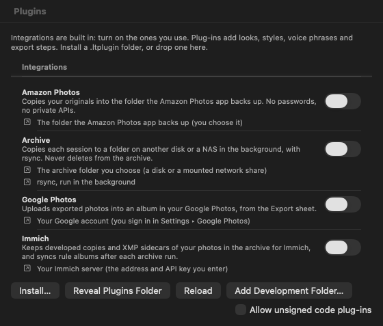 | 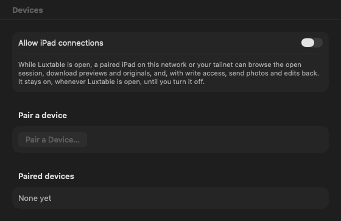 |

<details>
<summary><b>How it compares with Capture One and Lightroom Classic</b></summary>

This is a feature-level comparison based on the other products' publicly documented features. Those products change often, so check their own documentation for current details.

✅ yes · ◐ partial or limited · ❌ no

| Feature | Luxtable | Capture One | Lightroom Classic |
|---|---|---|---|
| **Library model** | | | |
| Session-based workflow (self-contained folders) | ✅ | ✅ | ❌ (catalog) |
| Catalog / cross-shoot library | ✅ Library mode across every session | ✅ | ✅ |
| Per-photo sidecars as the source of truth | ✅ | ✅ (sessions) | ◐ (XMP optional; catalog is primary) |
| Finds moved or renamed files by content | ✅ | ❌ | ❌ |
| Keywords and metadata editing | ✅ | ✅ | ✅ |
| Map view of photo locations | ✅ | ❌ | ✅ |
| **Import and culling** | | | |
| Card import with checksum verification | ✅ | ❌ | ❌ |
| Duplicate detection against everything already imported | ✅ | ◐ | ◐ |
| Instant culling from embedded previews | ✅ | ✅ | ✅ |
| Ratings, colour labels, pick/reject flags | ✅ | ✅ | ✅ |
| AI-assisted culling (sharpness, eyes, near-duplicates) | ✅ on device | ◐ | ◐ |
| Smart albums / smart collections | ✅ | ✅ | ✅ |
| Voice commands for culling | ✅ on device | ❌ | ❌ |
| Broad camera support | ◐ ([list](docs/CAMERAS.md)) | ✅ | ✅ |
| **Editing** | | | |
| GPU-accelerated develop pipeline | ✅ | ✅ | ✅ |
| Layers with brush, gradient, luminance and colour-range masks | ✅ | ✅ | ✅ (masks) |
| AI sky and subject masks | ✅ | ✅ | ✅ |
| AI noise reduction | ✅ on device | ✅ | ✅ |
| Object / distraction removal | ✅ | ✅ | ✅ |
| Auto adjustments | ✅ | ✅ | ✅ |
| Auto adjustments that explain every change | ✅ | ❌ | ❌ |
| Edit by typing what you want ("warmer, a bit brighter") | ✅ | ❌ | ❌ |
| Copy/apply chosen adjustment groups | ✅ | ✅ | ✅ |
| Aspect- and orientation-aware crop paste | ✅ | ◐ | ◐ |
| Relative (delta) exposure paste | ✅ | ◐ | ❌ |
| Variants / virtual copies | ✅ | ✅ | ✅ |
| Customisable, reorderable tool panels | ✅ | ✅ | ◐ |
| Match look across photos | ✅ | ✅ | ◐ |
| Perspective (keystone) correction | ✅ | ✅ | ✅ |
| Heal and clone spots | ✅ | ✅ | ✅ |
| Before/after and side-by-side compare | ✅ | ✅ | ✅ |
| Edit history list | ✅ per session | ❌ | ✅ |
| HDR merge | ✅ | ✅ | ✅ |
| Panorama stitching | ✅ | ✅ | ✅ |
| AI upscaling (super resolution) | ✅ on device | ❌ | ✅ |
| **Search** | | | |
| Natural-language photo search, on device | ✅ | ❌ | ❌ (cloud Lightroom only) |
| Face recognition and people | ✅ on device | ❌ | ✅ |
| **Output and backup** | | | |
| Export JPEG / HEIC / 16-bit TIFF / PNG | ✅ | ✅ | ✅ |
| Several export recipes in one go | ✅ | ✅ | ◐ |
| Watermarks on export | ✅ | ✅ | ✅ |
| Soft proofing | ✅ | ✅ | ✅ |
| Scheduled rsync archive to a NAS | ✅ | ❌ | ❌ |
| Backup hand-off to Amazon Photos | ✅ | ❌ | ❌ |
| Export straight to Google Photos | ✅ | ❌ | ❌ |
| Print, book or web modules | ❌ | ◐ print | ✅ |
| Tethered capture | ❌ | ✅ | ◐ |
| **Platform** | | | |
| Works fully offline; AI runs on device | ✅ | ◐ | ◐ |
| Mobile or tablet companion with sync | ❌ | ✅ iPad | ✅ |
| Plug-ins and extensions | ◐ looks, styles, voice phrases, export steps | ◐ | ✅ |
| Reads Capture One sessions and Lightroom Classic libraries | ✅ | ◐ Lightroom only | ❌ |
| Platforms | macOS (Apple silicon) | macOS, Windows, iPad | macOS, Windows |

Capture One is a trademark of Capture One A/S. Lightroom and Adobe are trademarks of Adobe. Luxtable is not affiliated with or endorsed by either company.

</details>

## How it works

### Architecture

The app is SwiftUI and AppKit. Everything that touches pixels or files is Rust, reached through one UniFFI facade (`lt-ffi`). On-device models run in the app through Core ML and Vision.

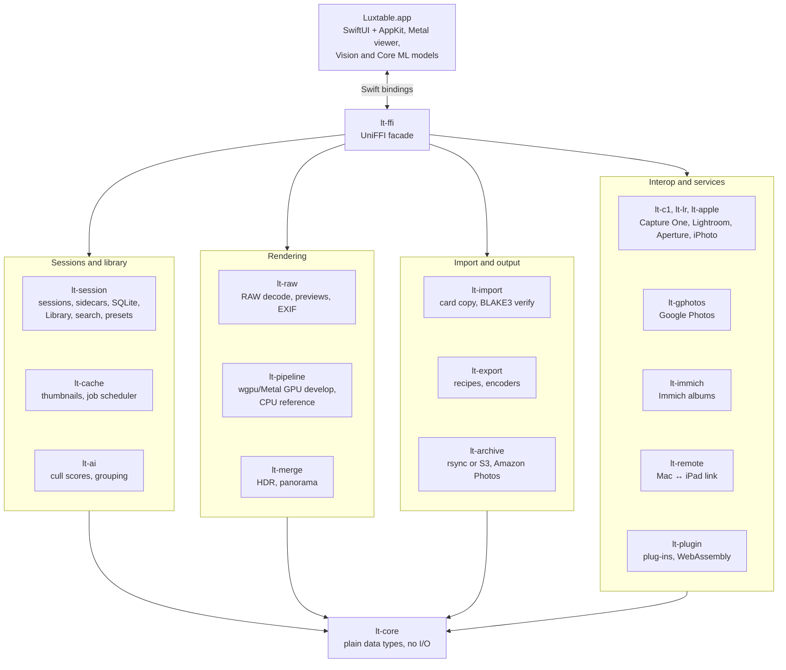

The crate contracts and performance budgets are in [docs/ARCHITECTURE.md](docs/ARCHITECTURE.md), and the Rust↔Swift interface in [docs/FFI.md](docs/FFI.md).

### From the card to the keepers

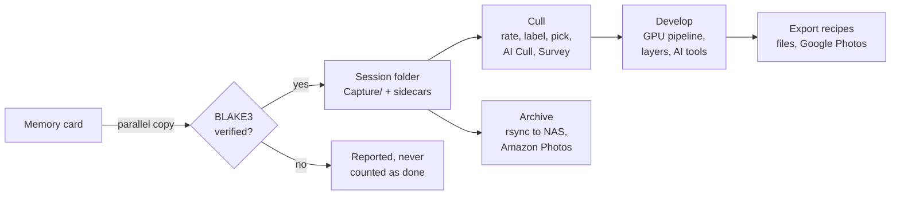

The card is only ever read. Duplicates of anything already imported are skipped, and an interrupted import resumes from its journal.

### The develop pipeline

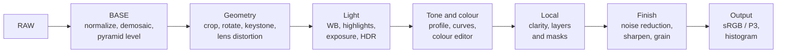

The BASE stage is cached per image and view level, so moving a slider, white balance included, only re-runs the develop stages. The CPU renderer is the reference; the GPU renderer must match it within ΔE2000 ≤ 0.05 on average. The full stage list is in [docs/ARCHITECTURE.md](docs/ARCHITECTURE.md#pipeline-staging-why-warm-renders-are-cheap).

### Sidecars are the source of truth

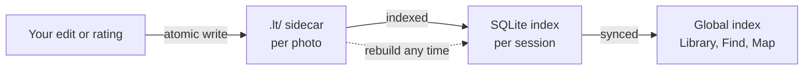

A session is a plain folder you can copy, archive or open on another Mac:

```
My Session/
  Capture/      originals
  Selects/      picks moved out of Capture
  Trash/        session trash (restorable)
  .lt/          sidecars (source of truth) and the rebuildable SQLite index
```

Luxtable can also open an existing folder of photos in place, without moving anything.

Coming from Darkslide (Luxtable's name before 0.2): the first launch copies its preferences, support folder and Keychain keys and leaves the originals alone, and each session's `.ds/` folder is renamed `.lt/` when the session is first opened, after which Darkslide 0.1 can't open that session any more ([user guide](docs/user-guide/14-migrate.md#coming-from-darkslide)).

## Supported cameras

The reference camera is the Sony A9 (ILCE-9). Sony ARW, Nikon NEF, Canon CR2 and CR3, Bayer Fujifilm RAF (GFX), OM System / Olympus ORF, Panasonic RW2, Pentax PEF and DNG, Leica DNG, phone DNGs and Apple ProRAW are tested and develop fully. Most of them need the free [RAW helper](#raw-decoding-and-the-raw-helper) (below). Fujifilm X-Trans RAFs and Nikon High Efficiency NEFs import and cull from their embedded previews but don't develop yet. [docs/CAMERAS.md](docs/CAMERAS.md) has the details, and with the RAW helper most other cameras supported by [rawler](https://github.com/dnglab/dnglab) should work.

### RAW decoding and the RAW helper

Luxtable decodes RAW files with its own decoders, written for this project under Apache-2.0 ([docs/RAWDEC.md](docs/RAWDEC.md)): DNG (including iPhone ProRAW, Pixel and Leica), Sony ARW, Canon CR2, Nikon NEF and Pentax PEF. They produce exactly the same sensor data as the [rawler](https://github.com/dnglab/dnglab) library Luxtable used before, or more exact values where rawler adds dither, and they're faster on every file tested:

| File | Format | Luxtable (ms) | rawler (ms) | Faster by |
|---|---|---:|---:|---:|
| Sony A9 | ARW uncompressed | 1.25 | 3.22 | 2.6× |
| Sony A7 III | ARW compressed | 4.9 | 8.5 | 1.7× |
| Sony A7 IV | ARW compressed | 7.0 | 11.9 | 1.7× |
| Canon EOS 5D Mark IV | CR2 | 152 | 206 | 1.4× |
| Canon EOS 6D Mark II | CR2 | 161 | 189 | 1.2× |
| Nikon D850 | NEF 14-bit lossless | 122 | 237 | 1.9× |
| Nikon Z 6II | NEF 14-bit lossless | 87 | 156 | 1.8× |
| Pentax K-3 Mark III | PEF | 74 | 137 | 1.8× |
| Pentax K-3 Mark III | DNG | 81 | 170 | 2.1× |
| Leica M10-R | DNG | 155 | 301 | 1.9× |
| Leica Q2 | DNG uncompressed | 4.0 | 11.2 | 2.8× |
| iPhone 12 Pro | ProRAW DNG | 17.8 | 35.8 | 2.0× |
| iPhone XS | DNG | 4.9 | 9.9 | 2.0× |
| Google Pixel 7 Pro | DNG | 7.0 | 12.4 | 1.8× |

*Full decode of one file to sensor data, release build, Apple M4 Pro, file in the page cache, median of 10 runs (`cargo bench -p lt-raw --bench raw -- decode/`, with the compatibility corpus from `scripts/fetch-rawcompat.sh`).*

**What rawler still does better:**

- **More formats:** Canon CR3, Fujifilm RAF, Olympus/OM ORF, Panasonic RW2, Minolta MRW and other older formats. Luxtable's own decoders don't read these yet.
- **More variants of the formats Luxtable does read:** lossy and 12-bit Nikon NEF, Canon CR2s from more bodies, and the older Pentax PEF code.
- **A camera database:** a non-DNG RAW file doesn't carry its colour matrix (and sometimes its crop and white level), so a decoder needs per-camera data. rawler has it for hundreds of cameras. Luxtable's own table has only data it may redistribute, which today is one camera (the Pentax K-3 Mark III).
- **Writing DNG:** HDR merges and panoramas are saved with rawler's DNG writer.

rawler is licensed under the LGPL-2.1, so it isn't built into Luxtable. It lives in a separate program, the **RAW helper** (`luxtable-rawler`), that you install only if you need it. Luxtable runs the helper for whatever its own decoders don't cover.

**Do you need it?**

| You shoot | Without the helper | With it |
|---|---|---|
| DNG (any camera, iPhone ProRAW, Pixel, Leica), Pentax K-3 Mark III | Develops | Develops |
| Sony ARW, Nikon NEF, Canon CR2 | Culling from the embedded preview: these need rawler's camera data | Develops |
| Canon CR3, Fujifilm RAF, Olympus/OM ORF, Panasonic RW2 and other formats | Culling from the embedded preview | Develops |
| HDR, panorama and Best Shot merges | Not available | Available |

**Getting it:**

- **In the app:** open **Settings ▸ RAW ▸ Download RAW Helper**, or click **Get RAW Helper** on a photo that needs it. Luxtable downloads it from this repository's [GitHub releases](https://github.com/sbaillar/luxtable/releases), checks it against the SHA-256 fingerprint built into the app, and installs it in `~/Library/Application Support/Luxtable/Helpers/`. Remove it in the same place.
- **From source:** `scripts/build-rawler-helper.sh --install`.
- **Licence:** the helper is distributed under the LGPL-2.1's terms. Its README, [crates/lt-rawler](crates/lt-rawler/README.md), explains how it works and how to rebuild it with a modified rawler.

## Install and build from source

Download the app from [Releases](https://github.com/sbaillar/luxtable/releases) (`Luxtable-X.Y.Z-macos-arm64.zip`; macOS 26, Apple silicon). It's ad-hoc signed, not notarized: the first time, right-click Luxtable.app and choose **Open**. From then on Luxtable updates itself (Settings ▸ Updates).

Or build it from source. You need:

- macOS 26 on Apple silicon, with the Xcode Command Line Tools (Swift 6.2). Xcode.app isn't needed.
- Rust 1.90 or newer (Homebrew `rust` or rustup).

```sh
git clone https://github.com/sbaillar/luxtable.git
cd luxtable
LT_SKIP_MODELS=1 scripts/build-app.sh --run      # build dist/Luxtable.app and launch it
dist/Luxtable.app/Contents/MacOS/Luxtable --demo   # try it on synthetic photos; touches none of your files
```

- `LT_SKIP_MODELS=1` skips converting the AI Denoise model (it needs Python 3.13); AI Denoise then shows as unavailable. Drop it for a full build.
- `scripts/build-app.sh --test` builds and runs the app's self-test.
- `scripts/make-signing-identity.sh` creates a local code-signing identity, so macOS keeps the app's permissions across rebuilds.

[CONTRIBUTING.md](CONTRIBUTING.md) has the full toolchain, the quality gates and how to run the tests.

### Updates and betas

Luxtable looks for a new version on this repository's [releases](https://github.com/sbaillar/luxtable/releases) shortly after it starts and then about once a day, and tells you with a small notice (never a dialog in the middle of culling). **Luxtable ▸ Check for Updates…** checks right away. The update sheet shows what changed; **Download & Restart** downloads it, checks it (SHA-256, bundle identifier, version, code signature), quits the normal way (pending changes are saved first) and reopens on the session and photo you were on. **Download** installs it the next time you quit, **Skip This Version** stops the reminders for that version. The version it replaces is kept in `~/Library/Application Support/Luxtable/Previous Version/` (one, replaced by the next update), so you can go back by dragging it to Applications.

**Settings ▸ Updates** turns automatic checks off and has **Include beta versions**: betas are GitHub pre-releases of the next version (`v0.1.19-beta.1`), for trying new features early; they may have bugs. Once that version is released, beta users are offered the release. How releases and betas are published: [docs/RELEASING.md](docs/RELEASING.md).

## Privacy and network use

Luxtable has no accounts, analytics or telemetry. Your photos stay on your Mac and the drives you choose. These are the only things that use the network, and only when you use them:

| What | When | What is sent |
|---|---|---|
| On-device AI models (remove, sky and people masks, lens blur depth, photo search) | Downloaded once from pinned upstream revisions on Hugging Face, the first time you use the feature; each file is checked against its SHA-256 | Download requests only; no photos |
| AI Upscale model | When you choose Download AI Upscale Model… and agree to its terms (builds that set a download location) | Download requests only |
| RAW helper | When you choose Download RAW Helper (Settings ▸ RAW, or on a photo that needs it); checked against its SHA-256 | Download requests to GitHub only |
| Update check | Shortly after launch and about once a day (Settings ▸ Updates turns it off), and when you choose Check for Updates… | One request to GitHub's releases API with only `Luxtable/<version>` as the User-Agent; no identifiers. Downloading an update fetches the release's zip from GitHub |
| Map tiles | In Map mode; asked once, and Settings ▸ General turns it off | The map areas you view are requested from Apple Maps; photos and their locations are never uploaded |
| Google Photos | Only with a Google Photos export recipe, after you sign in | The exported files, to your own account |
| Jev (TypeSafe) for Edit with words | Off by default; Settings ▸ AI with your own API key | The text you type, not the photo |
| Mac ↔ iPad link | Off by default; Settings ▸ Devices | Your session, to devices you paired, over mutually authenticated TLS on your network |
| Archive | When you set an archive target | To a folder: your sessions, copied by rsync to the drive or NAS you chose. To object storage: your sessions' files (originals, sidecars, developed copies, a snapshot of the session database), uploaded to the bucket you chose at the S3-compatible service you chose, signed with your access key (kept in your Keychain), with each file's BLAKE3 hash and modification time as object metadata, plus one small connection-test object when you press Test Connection |
| Immich | Only after you set up Settings ▸ Immich, at each album sync (after archive runs, or Sync Albums Now) | To your own Immich server, with your API key: the paths of the archived photos the album rules match (to find them there), album names and membership changes, and library scan requests. No photos are uploaded: Immich reads them from the archive |

Amazon Photos backup is a hand-off: Luxtable copies originals into a local folder and Amazon's own app uploads it.

## Documentation

- [User guide](docs/user-guide/README.md), one Markdown file per chapter, and as a [PDF](docs/Luxtable-User-Guide.pdf) built from them with `scripts/user-guide.sh`
- [Architecture and performance budgets](docs/ARCHITECTURE.md) · [Rust↔Swift FFI](docs/FFI.md) · [Benchmark method](docs/BENCHMARKS.md)
- [Supported cameras](docs/CAMERAS.md) · [Plug-ins](docs/PLUGINS.md) · [Mac ↔ iPad link protocol](docs/REMOTE.md) · [Google Photos setup](docs/GOOGLE_PHOTOS.md)
- [Capture One mapping](docs/C1_FORMAT.md) · [Lightroom mapping](docs/LR_FORMAT.md) · [Aperture and iPhoto mapping](docs/APPLE_FORMAT.md) · [AI Denoise model](docs/DENOISE_MODEL.md) · [AI Upscale model](docs/UPSCALE_MODEL.md)

## Roadmap

- **iPad app:** touch culling and light editing over the Mac ↔ iPad link ([docs/IPAD_PLAN.md](docs/IPAD_PLAN.md)).
- **Native RAW decoder:** more formats and cameras in `lt-raw` itself (CR3, RAF, ORF, RW2, X-Trans, camera data, a DNG writer), so fewer photos need the RAW helper.
- **Signed releases:** a Developer ID–signed, notarized build ([docs/RELEASING.md](docs/RELEASING.md)).

The product plan and its decisions are in [PLAN.md](PLAN.md).

## Contributing

Contributions are welcome. Read [CONTRIBUTING.md](CONTRIBUTING.md) for the toolchain, the gates every change must pass (formatting, zero clippy warnings, ≥ 90% test coverage, the app's self-test, licence checks) and the engineering rules in [CLAUDE.md](CLAUDE.md). Sign off every commit with the [Developer Certificate of Origin](https://developercertificate.org) (`git commit -s`); there is no CLA. Please read the [Code of Conduct](CODE_OF_CONDUCT.md), and report security issues as described in [SECURITY.md](SECURITY.md).

## Licence

Luxtable is licensed under the [Apache License 2.0](LICENSE); see also [NOTICE](NOTICE). Third-party licences are listed in [THIRD_PARTY_LICENSES.md](THIRD_PARTY_LICENSES.md).

Luxtable itself contains no LGPL code. The optional [RAW helper](crates/lt-rawler/README.md) is a separate program that statically links [rawler](https://github.com/dnglab/dnglab) (LGPL-2.1) and is distributed under the LGPL's terms; [CONTRIBUTING.md](CONTRIBUTING.md#relinking-rawler) shows how to rebuild it against a modified rawler.
