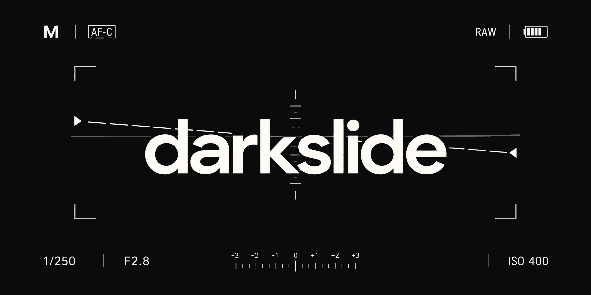
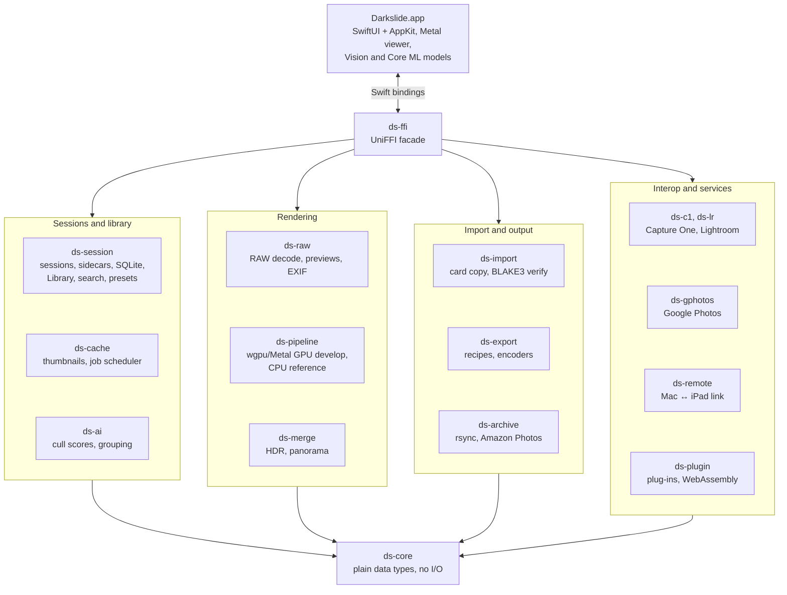
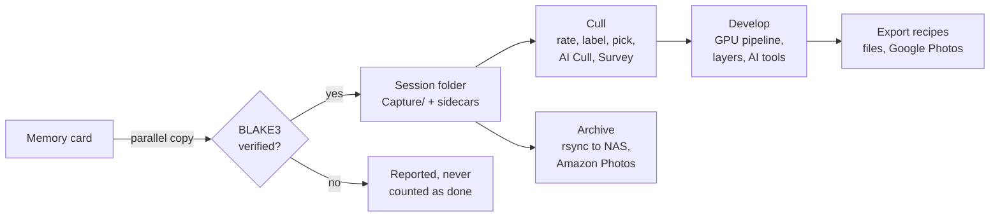
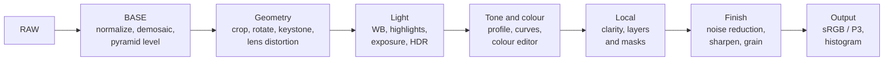
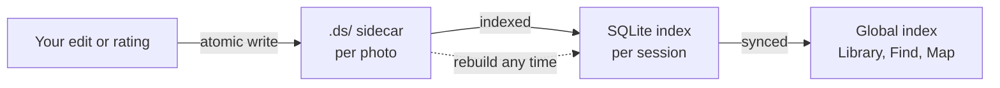

# Darkslide

<p align="center"></p>

<p align="center"><b>A fast, local-first RAW photo workflow for macOS.</b><br>
Card import, culling, sessions, editing, export and archiving, with a Rust core on the GPU and a native SwiftUI app.</p>

<p align="center">
  <a href="LICENSE"></a>
  
  <a href="docs/Darkslide-User-Guide.pdf"></a>
</p>


Darkslide is named after the plate that covers film in a holder. It is built for photographers who shoot a lot and want to get from the card to the keepers quickly: Capture One–style sessions, culling at the speed of your fingers, a GPU develop pipeline, and backups that never delete anything.

**Contents:** [Why Darkslide](#why-darkslide) · [Feature tour](#feature-tour) · [How it works](#how-it-works) · [Cameras](#supported-cameras) · [Install](#install-and-build-from-source) · [Privacy](#privacy-and-network-use) · [Docs](#documentation) · [Roadmap](#roadmap) · [Contributing](#contributing) · [Licence](#licence)

## Why Darkslide

- **Instant browsing.** Thumbnails come from the RAW file's embedded preview straight away, and full renders fill in behind them, visible photos first. Moving to the next photo with the keyboard takes under 50 ms.
- **Smooth editing.** The whole develop pipeline runs as GPU compute (Metal via wgpu). Dragging a slider re-renders a screen-sized proxy in 16 ms or less ([budgets](docs/ARCHITECTURE.md#budgets-release-build-m4-pro-a9-arw-file-in-page-cache)).
- **Sessions, not a catalog.** Each session is a self-contained folder. Per-photo sidecars are the source of truth, and the SQLite index can be rebuilt from them at any time. Sessions can live on any drive, including a NAS, and Library mode still shows every session's photos in one grid.
- **Your files are never lost.** Every write is atomic, imports are verified with BLAKE3 checksums before they count as done, nothing is ever deleted from a memory card or from the archive, and moved or renamed files are found again by content hash.
- **Nothing leaves your Mac unless you ask.** AI features run on device. What does use the network is listed under [Privacy and network use](#privacy-and-network-use).

## Feature tour

The screenshots are taken in demo mode (`--demo`): synthetic photos, no people, no real files. A full walk-through is in the [user guide (PDF)](docs/Darkslide-User-Guide.pdf).

### Import from a card

Darkslide detects memory cards, copies in parallel and verifies each file's checksum before the import counts as done. It skips anything already imported into any session, renames with templates, can resume an interrupted import, and offers a safe eject. Nothing is ever deleted from the card.


### Cull fast

- Grid, viewer, filmstrip and full-screen views. Space jumps to 100% at the cursor.
- Ratings (`1`–`5`), colour labels (`6`–`9`, `-`) and pick / reject flags (`P` / `X`), all on single keys you can rebind.
- **Multi-view:** select several photos and the viewer shows them all, the focused one outlined.
- **Survey** (`N` or ⌥⌘S) for side-by-side picks, before/after (`Y`), pin-to-compare (`K`) and burst stacks.
- **AI Cull** (⇧⌘K) scores sharpness, exposure and eyes on device and groups near-duplicates.
- **Voice culling** (⌃⌘V): say "pick", "reject", "three stars" or "next 3"; speech is recognised on device.
- Finish a cull in one step: rejects go to the session Trash and picks to Selects, both undoable.

| Grid | Multi-view | Survey |
|---|---|---|
|  |  |  |

### Library, Find and Map

- **Library mode** shows every session's photos in one grid without opening each session: browse by session, date or collection, filter by rating, label, flag, camera and keyword, and make collections and smart collections that span sessions. Ratings and labels you set there are written to the photo's own session.
- **Find** (⌘F) answers searches like "pics of alex at the beach" from the people you have named, places, dates, ratings and descriptive words, with the reason each result matched. Face grouping and photo search run on device.
- **Map** shows where photos were taken and filters the browser to an area; drag photos onto it to set their location (kept in the sidecar, never written to the RAW).

### Develop

A GPU pipeline with Capture One–style tool tabs you can rearrange, a CPU reference implementation it is tested against, and full-resolution 1:1 views.

- **Light and colour:** exposure, contrast, high dynamic range, levels, curves, white balance (presets, temperature/tint and a picker with a loupe), colour balance, colour editor, saturation and vibrance.
- **Looks, styles and presets** that preview as you hover, camera profiles (and imported Adobe DCP profiles), and Match exposure / white balance across photos.
- **Layers and masks:** brush, linear and radial gradients, luminance and colour range, and AI masks for sky, subject and people.
- **Remove and heal:** brush over a distraction and it is filled from its surroundings, or heal and clone spots.
- **Detail and lens:** clarity, structure, dehaze, sharpening, noise reduction, lens profiles, chromatic aberration, vignetting, keystone and an AI lens blur.
- **Crop and straighten** with aspect presets; drag along the horizon to level it.
- **Merge to HDR and Panorama** (⇧⌘H / ⇧⌘M): a new linear DNG next to the sources, with a RAW's full latitude.
- **Copy and apply** (⇧⌘C / ⇧⌘V): all edited adjustments or just the groups you tick, with aspect-aware crop paste and relative exposure paste.
- **Variants** (⌘D) and a per-session **History**.

| Live edit | White balance loupe |
|---|---|
|  |  |
| **Crop** | **1:1 zoom** |
|  |  |
| **Your own tool tabs** | **Edit with words** |
|  |  |

### AI that explains itself, on device

- **Edit with words** (⌘K): type "warmer and a bit brighter" and only what you name changes.
- **AI Optimize** (⌥⌘A) proposes measured adjustments and explains each one; you choose which to apply.
- **Auto Adjust** (⇧A) gives a one-key starting point.
- **AI Changes** (⌥⇧⌘A): every setting an AI tool changed is outlined, with its old and new value and why. Undo one or all of them; your own edits since are kept.
- **AI Denoise** and **AI Upscale** (2×) make new results on this Mac.


### Export, archive and back up

- **Export recipes** (⌘E): JPEG, HEIC, 16-bit TIFF and PNG; size, sharpening, colour space, naming, watermarks and metadata per recipe, several recipes in one go, in the background. Soft proofing (⇧S) shows the photo through any ICC profile.
- **Google Photos:** a recipe can also upload into an album in your Google Photos account ([setup](docs/GOOGLE_PHOTOS.md)).
- **Archive:** a background rsync of sessions to a drive or NAS, on a schedule. It never deletes from the archive.
- **Amazon Photos hand-off:** originals are copied into the folder Amazon Photos backs up.


### Plug-ins, iPad link and other apps

- **Plug-ins** (Settings ▸ Plugins): add looks, styles, voice phrases, or an export step written in WebAssembly that runs sandboxed. Nothing is granted at install ([docs/PLUGINS.md](docs/PLUGINS.md)).
- **Mac ↔ iPad link** (Settings ▸ Devices, off by default): a paired device can browse the open session and send photos and edits back over mutually authenticated TLS 1.3. The iPad app is planned; the `ds-remote` command-line client uses the link today ([docs/REMOTE.md](docs/REMOTE.md)).
- **Coming from Capture One or Lightroom Classic?** Darkslide reads Capture One sessions and settings and Lightroom Classic catalogs, XMP sidecars and presets, with a dry run first and a revert. It never modifies their files ([C1 mapping](docs/C1_FORMAT.md), [Lightroom mapping](docs/LR_FORMAT.md)).

| Plug-ins | Devices |
|---|---|
|  |  |

<details>
<summary><b>How it compares with Capture One and Lightroom Classic</b></summary>

This is a feature-level comparison based on the other products' publicly documented features. Those products change often, so check their own documentation for current details.

✅ yes · ◐ partial or limited · ❌ no

| Feature | Darkslide | Capture One | Lightroom Classic |
|---|---|---|---|
| **Library model** | | | |
| Session-based workflow (self-contained folders) | ✅ | ✅ | ❌ (catalog) |
| Catalog / cross-shoot library | ✅ Library mode across every session | ✅ | ✅ |
| Per-photo sidecars as the source of truth | ✅ | ✅ (sessions) | ◐ (XMP optional; catalog is primary) |
| Finds moved or renamed files by content | ✅ | ❌ | ❌ |
| Keywords and metadata editing | ✅ | ✅ | ✅ |
| Map view of photo locations | ✅ | ❌ | ✅ |
| **Import and culling** | | | |
| Card import with checksum verification | ✅ | ❌ | ❌ |
| Duplicate detection against everything already imported | ✅ | ◐ | ◐ |
| Instant culling from embedded previews | ✅ | ✅ | ✅ |
| Ratings, colour labels, pick/reject flags | ✅ | ✅ | ✅ |
| AI-assisted culling (sharpness, eyes, near-duplicates) | ✅ on device | ◐ | ◐ |
| Smart albums / smart collections | ✅ | ✅ | ✅ |
| Voice commands for culling | ✅ on device | ❌ | ❌ |
| Broad camera support | ◐ ([list](docs/CAMERAS.md)) | ✅ | ✅ |
| **Editing** | | | |
| GPU-accelerated develop pipeline | ✅ | ✅ | ✅ |
| Layers with brush, gradient, luminance and colour-range masks | ✅ | ✅ | ✅ (masks) |
| AI sky and subject masks | ✅ | ✅ | ✅ |
| AI noise reduction | ✅ on device | ✅ | ✅ |
| Object / distraction removal | ✅ | ✅ | ✅ |
| Auto adjustments | ✅ | ✅ | ✅ |
| Auto adjustments that explain every change | ✅ | ❌ | ❌ |
| Edit by typing what you want ("warmer, a bit brighter") | ✅ | ❌ | ❌ |
| Copy/apply chosen adjustment groups | ✅ | ✅ | ✅ |
| Aspect- and orientation-aware crop paste | ✅ | ◐ | ◐ |
| Relative (delta) exposure paste | ✅ | ◐ | ❌ |
| Variants / virtual copies | ✅ | ✅ | ✅ |
| Customisable, reorderable tool panels | ✅ | ✅ | ◐ |
| Match look across photos | ✅ | ✅ | ◐ |
| Perspective (keystone) correction | ✅ | ✅ | ✅ |
| Heal and clone spots | ✅ | ✅ | ✅ |
| Before/after and side-by-side compare | ✅ | ✅ | ✅ |
| Edit history list | ✅ per session | ❌ | ✅ |
| HDR merge | ✅ | ✅ | ✅ |
| Panorama stitching | ✅ | ✅ | ✅ |
| AI upscaling (super resolution) | ✅ on device | ❌ | ✅ |
| **Search** | | | |
| Natural-language photo search, on device | ✅ | ❌ | ❌ (cloud Lightroom only) |
| Face recognition and people | ✅ on device | ❌ | ✅ |
| **Output and backup** | | | |
| Export JPEG / HEIC / 16-bit TIFF / PNG | ✅ | ✅ | ✅ |
| Several export recipes in one go | ✅ | ✅ | ◐ |
| Watermarks on export | ✅ | ✅ | ✅ |
| Soft proofing | ✅ | ✅ | ✅ |
| Scheduled rsync archive to a NAS | ✅ | ❌ | ❌ |
| Backup hand-off to Amazon Photos | ✅ | ❌ | ❌ |
| Export straight to Google Photos | ✅ | ❌ | ❌ |
| Print, book or web modules | ❌ | ◐ print | ✅ |
| Tethered capture | ❌ | ✅ | ◐ |
| **Platform** | | | |
| Works fully offline; AI runs on device | ✅ | ◐ | ◐ |
| Mobile or tablet companion with sync | ❌ | ✅ iPad | ✅ |
| Plug-ins and extensions | ◐ looks, styles, voice phrases, export steps | ◐ | ✅ |
| Reads Capture One sessions and Lightroom Classic libraries | ✅ | ◐ Lightroom only | ❌ |
| Platforms | macOS (Apple silicon) | macOS, Windows, iPad | macOS, Windows |

Capture One is a trademark of Capture One A/S. Lightroom and Adobe are trademarks of Adobe. Darkslide is not affiliated with or endorsed by either company.

</details>

## How it works

### Architecture

The app is SwiftUI and AppKit. Everything that touches pixels or files is Rust, reached through one UniFFI facade (`ds-ffi`). On-device models run in the app through Core ML and Vision.



The crate contracts and performance budgets are in [docs/ARCHITECTURE.md](docs/ARCHITECTURE.md), and the Rust↔Swift interface in [docs/FFI.md](docs/FFI.md).

### From the card to the keepers



The card is only ever read. Duplicates of anything already imported are skipped, and an interrupted import resumes from its journal.

### The develop pipeline



The BASE stage is cached per image and view level, so moving a slider, white balance included, only re-runs the develop stages. The CPU renderer is the reference; the GPU renderer must match it within ΔE2000 ≤ 0.05 on average. The full stage list is in [docs/ARCHITECTURE.md](docs/ARCHITECTURE.md#pipeline-staging-why-warm-renders-are-cheap).

### Sidecars are the source of truth



A session is a plain folder you can copy, archive or open on another Mac:

```
My Session/
  Capture/      originals
  Selects/      picks moved out of Capture
  Trash/        session trash (restorable)
  .ds/          sidecars (source of truth) and the rebuildable SQLite index
```

Darkslide can also open an existing folder of photos in place, without moving anything.

## Supported cameras

The reference camera is the Sony A9 (ILCE-9). Sony ARW, Nikon NEF, Canon CR2 and CR3, Bayer Fujifilm RAF (GFX), OM System / Olympus ORF, Panasonic RW2, Pentax PEF and DNG, Leica DNG, phone DNGs and Apple ProRAW are tested and develop fully. Fujifilm X-Trans RAFs and Nikon High Efficiency NEFs import and cull from their embedded previews but don't develop yet. [docs/CAMERAS.md](docs/CAMERAS.md) has the details, and most other cameras supported by [rawler](https://github.com/dnglab/dnglab) should work.

## Install and build from source

There is no signed binary release yet; build it from source. You need:

- macOS 26 on Apple silicon, with the Xcode Command Line Tools (Swift 6.2). Xcode.app isn't needed.
- Rust 1.90 or newer (Homebrew `rust` or rustup).

```sh
git clone https://github.com/sbaillar/darkslide.git
cd darkslide
DS_SKIP_MODELS=1 scripts/build-app.sh --run      # build dist/Darkslide.app and launch it
dist/Darkslide.app/Contents/MacOS/Darkslide --demo   # try it on synthetic photos; touches none of your files
```

- `DS_SKIP_MODELS=1` skips converting the AI Denoise model (it needs Python 3.13); AI Denoise then shows as unavailable. Drop it for a full build.
- `scripts/build-app.sh --test` builds and runs the app's self-test.
- `scripts/make-signing-identity.sh` creates a local code-signing identity, so macOS keeps the app's permissions across rebuilds.

[CONTRIBUTING.md](CONTRIBUTING.md) has the full toolchain, the quality gates and how to run the tests.

## Privacy and network use

Darkslide has no accounts, analytics or telemetry. Your photos stay on your Mac and the drives you choose. These are the only things that use the network, and only when you use them:

| What | When | What is sent |
|---|---|---|
| On-device AI models (remove, sky and people masks, lens blur depth, photo search) | Downloaded once from pinned upstream revisions on Hugging Face, the first time you use the feature; each file is checked against its SHA-256 | Download requests only; no photos |
| AI Upscale model | When you choose Download AI Upscale Model… and agree to its terms (builds that set a download location) | Download requests only |
| Map tiles | In Map mode; asked once, and Settings ▸ General turns it off | The map areas you view are requested from Apple Maps; photos and their locations are never uploaded |
| Google Photos | Only with a Google Photos export recipe, after you sign in | The exported files, to your own account |
| Jev (TypeSafe) for Edit with words | Off by default; Settings ▸ AI with your own API key | The text you type, not the photo |
| Mac ↔ iPad link | Off by default; Settings ▸ Devices | Your session, to devices you paired, over mutually authenticated TLS on your network |
| Archive | When you set an archive target | Your sessions, copied by rsync to the drive or NAS you chose |

Amazon Photos backup is a hand-off: Darkslide copies originals into a local folder and Amazon's own app uploads it.

## Documentation

- [User guide (PDF)](docs/Darkslide-User-Guide.pdf), built from [docs/user-guide/](docs/user-guide/) with `scripts/user-guide.sh`
- [Architecture and performance budgets](docs/ARCHITECTURE.md) · [Rust↔Swift FFI](docs/FFI.md) · [Benchmark method](docs/BENCHMARKS.md)
- [Supported cameras](docs/CAMERAS.md) · [Plug-ins](docs/PLUGINS.md) · [Mac ↔ iPad link protocol](docs/REMOTE.md) · [Google Photos setup](docs/GOOGLE_PHOTOS.md)
- [Capture One mapping](docs/C1_FORMAT.md) · [Lightroom mapping](docs/LR_FORMAT.md) · [AI Denoise model](docs/DENOISE_MODEL.md) · [AI Upscale model](docs/UPSCALE_MODEL.md)

## Roadmap

- **iPad app:** touch culling and light editing over the Mac ↔ iPad link ([docs/IPAD_PLAN.md](docs/IPAD_PLAN.md)).
- **Native RAW decoder:** RAW decoding in `ds-raw` itself, so fewer formats depend on rawler and more of them develop (X-Trans among them).
- **Signed releases:** a Developer ID–signed, notarized build ([docs/RELEASING.md](docs/RELEASING.md)).

The product plan and its decisions are in [PLAN.md](PLAN.md).

## Contributing

Contributions are welcome. Read [CONTRIBUTING.md](CONTRIBUTING.md) for the toolchain, the gates every change must pass (formatting, zero clippy warnings, ≥ 90% test coverage, the app's self-test, licence checks) and the engineering rules in [CLAUDE.md](CLAUDE.md). Sign off every commit with the [Developer Certificate of Origin](https://developercertificate.org) (`git commit -s`); there is no CLA. Please read the [Code of Conduct](CODE_OF_CONDUCT.md), and report security issues as described in [SECURITY.md](SECURITY.md).

## Licence

Darkslide is licensed under the [Apache License 2.0](LICENSE); see also [NOTICE](NOTICE). Third-party licences are listed in [THIRD_PARTY_LICENSES.md](THIRD_PARTY_LICENSES.md).

Darkslide statically links [rawler](https://github.com/dnglab/dnglab), which is licensed under the LGPL-2.1. You can rebuild and relink the app against a modified rawler; [CONTRIBUTING.md](CONTRIBUTING.md#relinking-rawler) shows how.
