# Welcome to Luxtable

Luxtable is a RAW photo workflow app for macOS. It takes you from a memory card to finished, backed-up photos: import and verify, cull, develop, export and archive. It is built around three ideas.

- **Speed where you spend your time.** Thumbnails appear straight away from the preview each RAW file carries, and full renders fill in behind them. Culling is driven by single keys, and the develop pipeline runs on the GPU, so sliders respond as you drag.
- **Sessions you own.** A session is an ordinary folder: your originals, plus a small sidecar file per photo that holds its rating, labels, keywords and edits. The sidecars are the source of truth. Luxtable keeps a database alongside them only to be fast, and can rebuild it from the sidecars at any time. Library mode still shows every session's photos together.
- **Never losing a file.** Imports are checked byte for byte before they count as done. Luxtable never deletes anything from a memory card or from your archive, and every file it writes is written in full before it replaces the old one.

## The main window

The main window has a toolbar at the top, the browser in the middle and the tools beside it.

- **Toolbar:** the session menu, Import, the view switch (**Viewer**, **Grid**, **Map**, **Library**), the **Edit with words** field (`⌘K`), archive status and the **Copy** / **Apply** buttons.
- **Browser:** the viewer with a filmstrip, or a grid of thumbnails. The filmstrip can sit at the bottom or as a column on the left or right (**View ▸ Filmstrip**).
- **Tools:** tabs of tool panels (Library, Import & Archive, Color, Exposure, Lens, Composition, Details, Layers, Metadata, Output, and your Favorites). **View ▸ Tools on Left** moves them to the other side.

Press `?` at any time for a cheat sheet of the keys, and `F` or `Tab` to hide the panels and see only the photo.
