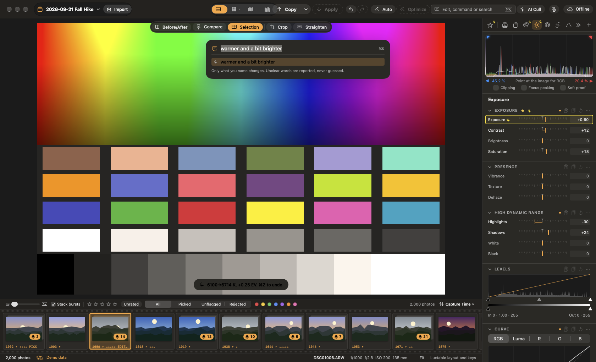
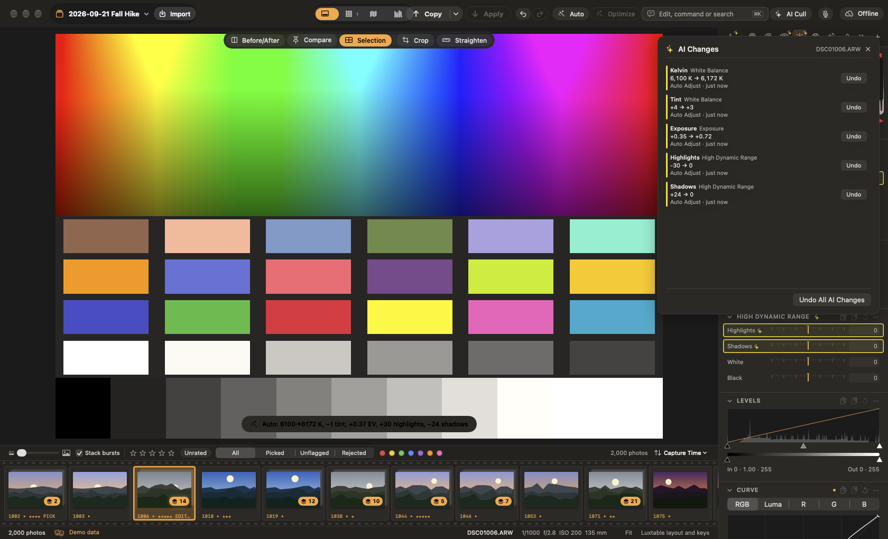

# AI tools

Darkslide's AI tools run on your Mac. Some of their models are downloaded once, the first time you use the tool; your photos are never uploaded. Every change an AI tool makes is shown and can be undone on its own.

## Edit with words

Press `⌘K` and type what you want, for example "warmer and a bit brighter" or "less contrast, more shadows". Darkslide changes only what you name and tells you what it did. Optionally, Settings ▸ AI can send the text (never the photo) to the Jev service with your own API key for phrasing the built-in parser doesn't understand.

## Auto Adjust and AI Optimize

- **Auto Adjust** (`⇧A` or `⇧⌘A`) sets white balance and tone as a quick starting point.
- **AI Optimize** (`⌥⌘A`) looks at the photo (the scene, faces, sky, noise) and proposes measured adjustments, each with the reason. Choose which ones to apply.
- **AI Looks** suggests three or four looks that suit the photo (a person, low light, a landscape, a sunset), each with the reason.

## AI Changes

Every setting that AI Optimize, Edit with words or Auto Adjust changed gets a yellow outline in the tools. Its tooltip says what it was changed to, from what, and why. **Adjustments ▸ AI Changes…** (`⌥⇧⌘A`) lists them all with who changed them and when. Undo one, or **Undo All AI Changes**; your own edits made since are kept. The list is saved in the sidecar.

## AI Denoise and AI Upscale

- **AI Denoise** (Noise Reduction panel) removes noise with a neural network on the Neural Engine and GPU. Turn it on for the selected photos and they are denoised in the background; exports denoise just before they render.
- **AI Upscale** (**Photo ▸ Enhance ▸ Upscale 2×**) makes a new photo twice the size on each side, kept as a linear DNG next to the original with its edit. Export recipes can enlarge with it too. Its model is downloaded the first time, after you agree to its terms.

AI Cull and voice commands are described in [Culling](04-culling.md#ai-cull), and AI masks and lens blur in [Developing](06-develop.md#layers-and-masks).
