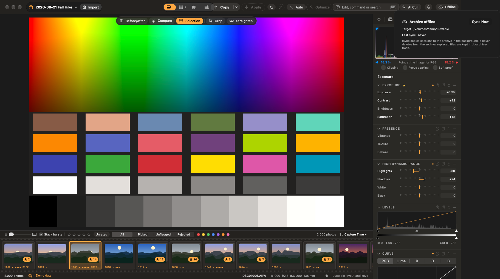

# Archive, Immich and Amazon Photos

Archive, Immich and Amazon Photos are [optional integrations](12-plugins.md#optional-integrations). Each is off until you turn it on in Settings ▸ Plugins ▸ Integrations, and its Settings pane appears while it is on.

## Archive

Luxtable can copy your sessions to an archive in the background: a folder (for example on a NAS) or S3-compatible object storage. Set it up in Settings ▸ Archive or the Import & Archive tab, and tick **Archive sessions in the background**.

- The archive runs when there are changes, after an import and when you close a session, and checks on the interval you choose (**Check every**).
- Choose whether rejected photos are archived too (**Archive rejected photos**). With it off, rejects and the session's Trash stay out of the archive.
- Each session gets its own folder in the archive. Switching destinations never moves or deletes what is already archived.
- The archive button in the toolbar shows the status: up to date, behind, offline or a problem, with the recent runs.

### A folder

Choose **Folder** as the **Destination**, then a folder on a mounted volume (a NAS share or an external drive) or on this Mac. Luxtable copies to it with rsync. Nothing is written while the volume isn't mounted: changes wait, and the archive catches up when it is back. A local folder must already exist (**Create It** makes it), and can't be inside a session.

### Object storage

Choose **Object storage** as the **Destination** to archive to any S3-compatible service, such as Amazon S3, Backblaze B2, Wasabi, Cloudflare R2 or MinIO. Fill in:

- **Endpoint:** the service's S3 address. Leave it empty for Amazon S3, where the region picks it.
- **Region**, for example `us-east-1` (Cloudflare R2 uses `auto`).
- **Bucket** and **Path**: the path is a key prefix, so `luxtable/` puts a session at `luxtable/<session>/…`.
- **Path-style addressing**, if the service needs it (MinIO and some others do).
- **Access key ID** and **Secret access key**. They are kept only in your Keychain, never in preferences or files, and the secret is never shown again. **Remove Keys** deletes them.

**Save**, then **Test Connection**: it checks the bucket and leaves one small test object under the path, in `.lt-archive-test/`.

The endpoint must use `https://`. Plain `http://` is accepted only for a server on your local network (such as a MinIO on your LAN), so your files and keys never cross the internet unencrypted.

Unchanged files are skipped, every upload is verified, and large files go up in parts. Only a consistent snapshot of the session database is archived, never the live one, and caches and half-written files stay out.

### Never deletes

The archive never deletes anything. A file that changed is archived again only after its previous version is moved aside, into `.lt-archive-trash/` with the time: in the archive folder, or under the path in the bucket. Developed copies and XMP sidecars for Immich travel with the session.

## Immich

[Immich](https://immich.app) is a self-hosted photo server. Luxtable works with an Immich server that indexes your archive folder as an **external library** (mounted read-only is fine): Luxtable never uploads to Immich, and Immich never writes to the archive. Turn Immich on in Settings ▸ Plugins, then set it up in Settings ▸ Immich.

1. **Server:** enter the server address and an API key (create it in Immich under Account Settings ▸ API Keys; it is kept in your Keychain). **Save**, then **Test Connection**.
2. **Where Immich sees the archive:** the archive folder as the server sees it and as this Mac sees it, for example `/mnt/photos` on the server is `/Volumes/photos` on this Mac. **Detect** fills it in from an archived photo Immich already has, or from the library's import path.
3. **Developed copies:** choose the photos you want in Immich as you edited them, then **Photo ▸ Keep a Developed Copy for Immich** (also in the browser's context menu). A JPEG with every edit goes to the session's `Developed/` folder, and the archive carries it to the NAS. It is rendered again when you edit, re-rate or re-tag the photo. A badge on the thumbnail shows the copy (orange when it is out of date). Set the JPEG quality and size in Settings ▸ Immich. **Photo ▸ Stop Updating Developed Copy** leaves the existing file alone, since nothing deletes from the archive.
4. **XMP sidecars:** with **XMP sidecars next to the originals** on (the default), `IMG_0001.ARW.xmp` next to each archived original carries the stars, title, caption, keywords and position, so RAWs show them in Immich too. With **Colour label and pick as tags** on, the colour label and the pick or reject flag go in as tags as well. A sidecar Luxtable didn't write (from Lightroom or Capture One) is never touched.
5. **Albums:** each album follows a rule, such as a minimum star rating, picked photos only, a colour label or a keyword ("★★★★★" → "Luxtable ★★★★★"), across every archived session. **Add Album** adds one. After each archive run, or **Sync Albums Now**, Luxtable asks Immich to rescan, then adds the matching photos (the developed copy when there is one, otherwise the original) and removes only the photos it added itself. Photos you put in an album by hand stay.

Rate and tag in Luxtable: Immich shows what the sidecars and developed copies say. If you only want the developed JPEGs in Immich, add the exclusion pattern `**/*.ARW` (and your other RAW extensions) to the external library. Album changes and scan requests are the only things Luxtable asks of Immich; scans need an admin's API key (otherwise Immich finds new files on its own schedule).

Immich needs a folder it can index, so it needs the archive to go to a folder. With object storage, album sync is skipped, and Settings ▸ Immich says so.

## Amazon Photos hand-off

Amazon Photos has no public API, so Luxtable mirrors your originals into a folder that the official Amazon Photos app backs up. Turn it on in Settings ▸ Plugins, then choose that folder in Settings ▸ Amazon Photos, and choose whether rejected photos are sent too. It works with either archive destination.
